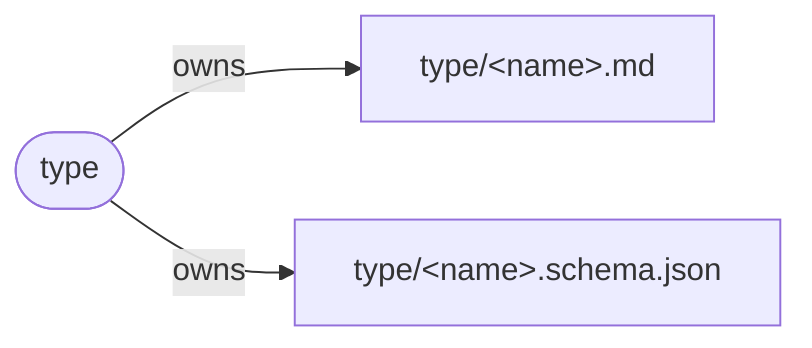
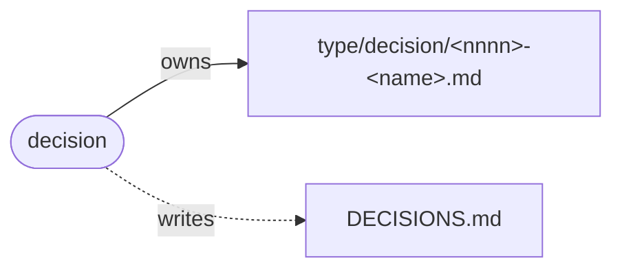
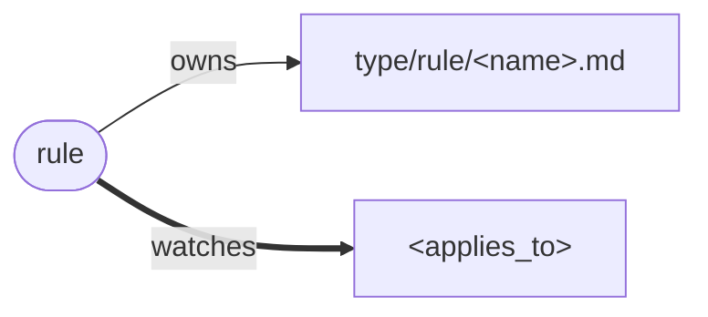
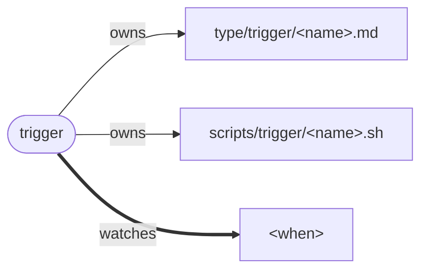
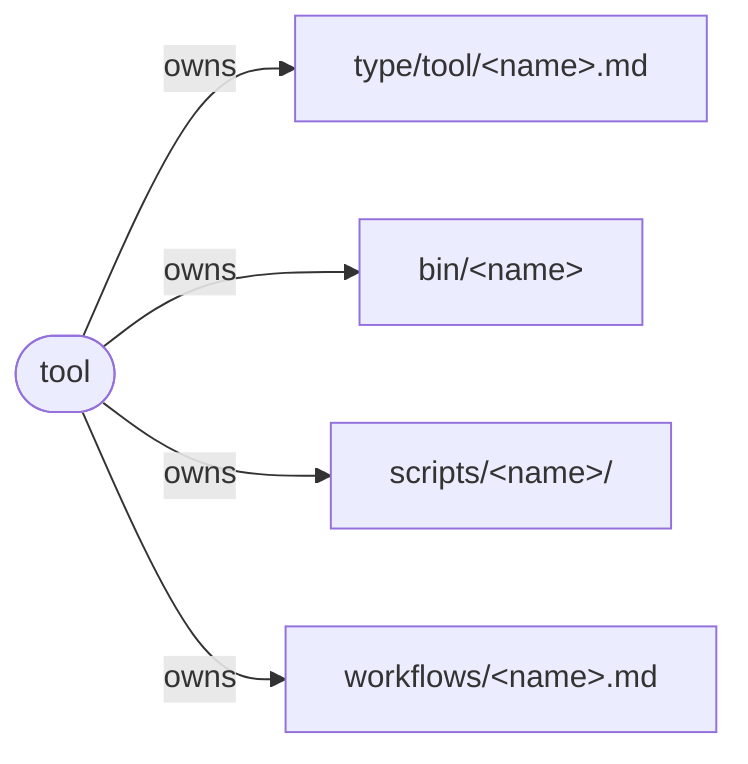
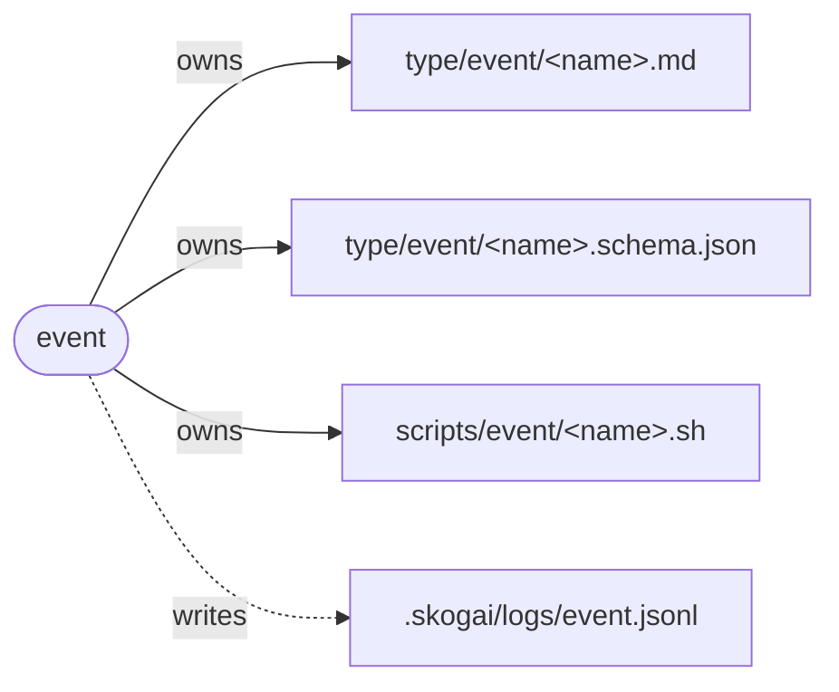
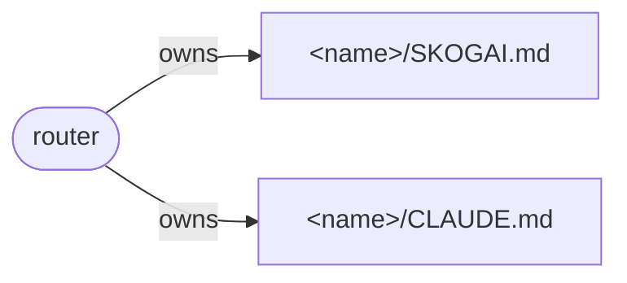

<!-- generated by tmp/graph/types.sh from type/*.md at f8ea24f. do not edit: change type/*.md and run mise run dash:graph. -->
# dash-skogai types

one section per type, in [type/index.md](type/index.md) order. each type says which files every instance of it **owns** (creates and manages, exactly one owner), **writes** (modifies without owning) and **watches** (reads, wants to know about changes). `<name>` in a path is the instance's name.

## type

a kind of thing, and the files each of its instances owns, writes and watches.



- **fields:** `type`, `title`, `description`, `fields`, `owns`, `writes`, `watches`
- **owns:** `type/<name>.md`, `type/<name>.schema.json`

a type defines a kind of thing. its definition is `type/<name>.md`, its instances live in `type/<name>/`, and `type/<name>.schema.json`, when there is one, is the schema for those instances. so [type.schema.json](type/type.schema.json) is the schema for every type definition.

### base

every instance of every type has the okf base. okf requires only `type`; the rest is optional:

- **identity**: `type`, `title`, `description`.
- **provenance**: `sources[]`, `usage_window`.
- **trust**: `generated: {by, at}`, `verified[]`.
- **lifecycle**: `status`, `stale_after`.

### definition

every type states:

- **type**: `type`.
- **title**: its name. instances carry it as their `type` in frontmatter.
- **fields**: the frontmatter every instance must have, beyond `type`.
- **owns**: the paths each instance creates and manages fully. every path has exactly one owner.
- **writes**: the paths each instance modifies without owning them.
- **watches**: the paths each instance reads and wants to know about when they change.

`<name>` in a path is the instance's name. a path ending in `/` is a folder.

### check

- a file with no owner is untyped: an error.
- a file with two owners is a conflict: an error.
- ownership is one step. `type` owns `type/tool.md`; `tool` owns `type/tool/gita.md`. `type` never owns what is under `type/tool/`.
- `writes` and `watches` can overlap freely.

`type` is itself a type: every `type/<name>.md` is an instance of it, including this file.

## decision

a choice and why it was made, written once.



- **fields:** `type`, `title`, `status`
- **owns:** `type/decision/<nnnn>-<name>.md`
- **writes:** `DECISIONS.md`

a decision records a choice and why. it is written once and never edited.

- **status**: `proposed`, `accepted` or `superseded`.
- **supersedes**: optional, the number of the decision this one replaces.

to change a decision, write a new one that supersedes it. `DECISIONS.md` is derived from the instances and never edited by hand.

## rule

a constraint that can be checked, enforcing a decision.



- **fields:** `type`, `title`, `applies_to`
- **owns:** `type/rule/<name>.md`
- **watches:** `<applies_to>`

a rule is a decision made checkable.

- **applies_to**: the paths the rule constrains. the rule watches them and is re-checked when they change.
- **from**: optional, the decision it enforces.

a "we do X" that cannot be checked is a decision, not a rule.

## trigger

a script that runs when a file changes or an event happens.



- **fields:** `type`, `title`, `when`
- **owns:** `type/trigger/<name>.md`, `scripts/trigger/<name>.sh`
- **watches:** `<when>`

a trigger `<name>` owns:

- `type/trigger/<name>.md`: the instance.
- `scripts/trigger/<name>.sh`: what runs.

- **when**: the paths or events that run the script.

the base `watches` field is the simplest trigger: it marks interest in a path and runs nothing. a trigger adds the script.

## tool

an executable skogai uses, with its wrapper, scripts and workflow.



- **fields:** `type`, `title`
- **owns:** `type/tool/<name>.md`, `bin/<name>`, `scripts/<name>/`, `workflows/<name>.md`
- **instances:** [gita](type/tool/gita.md), [herdr](type/tool/herdr.md), [mise](type/tool/mise.md), [okn (openknowledge executable)](type/tool/okn.md), [skogai](type/tool/skogai.md), [wt (worktrunk)](type/tool/wt.md)

instances: [herdr](type/tool/herdr.md), [wt](type/tool/wt.md), [gita](type/tool/gita.md), [mise](type/tool/mise.md), [okn](type/tool/okn.md), [skogai](type/tool/skogai.md).

a tool `<name>` owns:

- `type/tool/<name>.md`: the instance, and its documentation.
- `bin/<name>`: the entrypoint.
- `scripts/<name>/`: everything the entrypoint calls.
- `workflows/<name>.md`: how and when to use it.

## task

_stub: no definition yet._

## knowledge

_stub: no definition yet._

## memory

_stub: no definition yet._

## repo

_stub: no definition yet._

## spec

_stub: no definition yet._

## event

something that happened, recorded as one row appended to the event log.



- **fields:** `type`, `title`
- **owns:** `type/event/<name>.md`, `type/event/<name>.schema.json`, `scripts/event/<name>.sh`
- **writes:** `.skogai/logs/event.jsonl`
- **instances:** [Notification](type/event/notification.md), [PostCompact](type/event/postcompact.md), [PostToolUseFailure](type/event/posttoolusefailure.md), [PostToolUse](type/event/posttooluse.md), [PreCompact](type/event/precompact.md), [PreToolUse](type/event/pretooluse.md), [SessionEnd](type/event/sessionend.md), [SessionStart](type/event/sessionstart.md), [StopFailure](type/event/stopfailure.md), [Stop](type/event/stop.md), [SubagentStart](type/event/subagentstart.md), [SubagentStop](type/event/subagentstop.md), [UserPromptSubmit](type/event/userpromptsubmit.md)

an event is something that happened, such as a turn ending or a tool about to run. each time it happens, one row is appended to the event log. rows are never edited; the log as a whole is temporary and can be deleted.

an event `<name>` owns:

- `type/event/<name>.md`: the instance. it says what happened and when it fires.
- `type/event/<name>.schema.json`: its rows. it narrows the row in [event.schema.json](type/event.schema.json) to this event's `input`.
- `scripts/event/<name>.sh`: what runs when it happens.

- **enabled**: optional. an event runs only when this is `true`. missing, or no instance at all, is off.

### the row

one json object per line in `.skogai/logs/event.jsonl`:

- **ts**: when it happened, utc, to the millisecond.
- **event**: the instance's `title`.
- **action**: optional, what the script did, when it did more than record the row.
- **input**: everything the event came with, unchanged. `$defs/input` in the schema lists the fields every event shares; `type/event/<name>.schema.json` adds its own and says which are required.

### the script

`scripts/event/<name>.sh` gets the event's `input` and appends exactly one row. it may answer: go on, stop with a reason, or a structured answer the event's source understands. when it can't run, it says so and lets the event go on, so a broken script never stops work.

### defaults

no event is on. the log path is the base config key `event.log-path`.

## router

**status:** draft

a file that points to other files, so an agent loads only what the task needs.



- **fields:** `type`, `title`
- **owns:** `<name>/SKOGAI.md`, `<name>/CLAUDE.md`

a router routes, it does not hold content. its body is one `<routes>` block: the frontmatter `type` names the block, as `router` names `<routes>`.

```markdown
---
type: router
title: dash-skogai
---

<routes>

- @type/index.md - small index, loaded with the router
- tmp/ - untyped or undecided, read when needed

</routes>
```

- **entries**: one per line, `- <path> [- <description>]`. the description lets an agent decide without opening the file.
- **`@path`**: loaded with the router. use it for small routers and indexes.
- **plain path**: listed, read on demand. use it for anything with real content.
- **no transitive bloat**: a router never `@`-links a file that itself `@`-links content. that loads everything below it.
- **one step**: each router points to the next level, never to everything.

### CLAUDE.md

claude code loads only `CLAUDE.md`, never `SKOGAI.md`. so each router also owns the `CLAUDE.md` next to it, and that file is derived: its whole content is

```markdown
@SKOGAI.md
```

it is never hand-edited, and `check` regenerates and compares it. routes go in `SKOGAI.md`, not in `CLAUDE.md`.

the source this was folded from is [tmp/routing](type/../tmp/routing/README.md).

