<!-- generated by tmp/graph/types.sh from type/*.md at 235b3d4. do not edit. -->
# types

```mermaid
flowchart LR
  classDef type fill:#dbeafe,stroke:#1d4ed8,color:#0b1b3a
  classDef draft fill:#fef3c7,stroke:#b45309,color:#3a2604
  classDef stub fill:#f3f4f6,stroke:#9ca3af,color:#6b7280,stroke-dasharray:4 3
  classDef inst fill:#dcfce7,stroke:#15803d,color:#052e16
  classDef path fill:#ffffff,stroke:#6b7280,color:#111827

  t_config(["config"]):::type
  t_decision(["decision"]):::type
  t_event(["event"]):::type
  t_knowledge(["knowledge"]):::stub
  t_memory(["memory"]):::stub
  t_repo(["repo"]):::stub
  t_router(["router"]):::draft
  t_rule(["rule"]):::type
  t_spec(["spec"]):::stub
  t_task(["task"]):::stub
  t_tool(["tool"]):::type
  t_trigger(["trigger"]):::type
  t_type(["type"]):::type
  p0[".skogai/logs/event.jsonl"]:::path
  p1["#lt;applies_to#gt;"]:::path
  p2["#lt;name#gt;/CLAUDE.md"]:::path
  p3["#lt;name#gt;/SKOGAI.md"]:::path
  p4["#lt;when#gt;"]:::path
  p5["DECISIONS.md"]:::path
  p6["bin/#lt;name#gt;"]:::path
  p7["config"]:::path
  p8["scripts/#lt;name#gt;/"]:::path
  p9["scripts/event/#lt;name#gt;.sh"]:::path
  p10["scripts/trigger/#lt;name#gt;.sh"]:::path
  p11["type/#lt;name#gt;.md"]:::path
  p12["type/#lt;name#gt;.schema.json"]:::path
  p13["type/#lt;name#gt;/"]:::path
  p14["type/decision/#lt;nnnn#gt;-#lt;name#gt;.md"]:::path
  p15["type/event/#lt;name#gt;.md"]:::path
  p16["type/event/#lt;name#gt;.schema.json"]:::path
  p17["type/rule/#lt;name#gt;.md"]:::path
  p18["type/tool/#lt;name#gt;.md"]:::path
  p19["type/trigger/#lt;name#gt;.md"]:::path
  p20["workflows/#lt;name#gt;.md"]:::path

  t_config -->|owns| p7
  t_decision -->|owns| p14
  t_event -->|owns| p15
  t_event -->|owns| p16
  t_event -->|owns| p9
  t_router -->|owns| p3
  t_router -->|owns| p2
  t_rule -->|owns| p17
  t_tool -->|owns| p18
  t_tool -->|owns| p6
  t_tool -->|owns| p8
  t_tool -->|owns| p20
  t_trigger -->|owns| p19
  t_trigger -->|owns| p10
  t_type -->|owns| p11
  t_type -->|owns| p12
  t_type -->|owns| p13
  t_decision -.->|writes| p5
  t_event -.->|writes| p0
  t_rule ==>|watches| p1
  t_trigger ==>|watches| p4
  i0["gita"]:::inst
  t_tool --- i0
  i1["herdr"]:::inst
  t_tool --- i1
  i2["mise"]:::inst
  t_tool --- i2
  i3["okn"]:::inst
  t_tool --- i3
  i4["skogai"]:::inst
  t_tool --- i4
  i5["wt"]:::inst
  t_tool --- i5
```

blue: type. yellow: draft. grey dashed: stub with no frontmatter. green: instance. solid: owns, dashed: writes, thick: watches.
every type is also an instance of `type`; those edges are left out.

| type | fields | owns | writes | watches | instances |
|---|---|---|---|---|---|
| [config](../../type/config.md) | `type`, `title` | `config` |  |  |  |
| [decision](../../type/decision.md) | `type`, `title`, `status` | `type/decision/<nnnn>-<name>.md` | `DECISIONS.md` |  |  |
| [event](../../type/event.md) | `type`, `title` | `type/event/<name>.md`, `type/event/<name>.schema.json`, `scripts/event/<name>.sh` | `.skogai/logs/event.jsonl` |  |  |
| [knowledge](../../type/knowledge.md) |  |  |  |  |  |
| [memory](../../type/memory.md) |  |  |  |  |  |
| [repo](../../type/repo.md) |  |  |  |  |  |
| [router](../../type/router.md) | `type`, `title` | `<name>/SKOGAI.md`, `<name>/CLAUDE.md` |  |  |  |
| [rule](../../type/rule.md) | `type`, `title`, `applies_to` | `type/rule/<name>.md` |  | `<applies_to>` |  |
| [spec](../../type/spec.md) |  |  |  |  |  |
| [task](../../type/task.md) |  |  |  |  |  |
| [tool](../../type/tool.md) | `type`, `title` | `type/tool/<name>.md`, `bin/<name>`, `scripts/<name>/`, `workflows/<name>.md` |  |  | gita, herdr, mise, okn, skogai, wt |
| [trigger](../../type/trigger.md) | `type`, `title`, `when` | `type/trigger/<name>.md`, `scripts/trigger/<name>.sh` |  | `<when>` |  |
| [type](../../type/type.md) | `type`, `title`, `description`, `fields`, `owns`, `writes`, `watches` | `type/<name>.md`, `type/<name>.schema.json`, `type/<name>/` |  |  |  |

